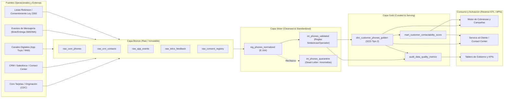
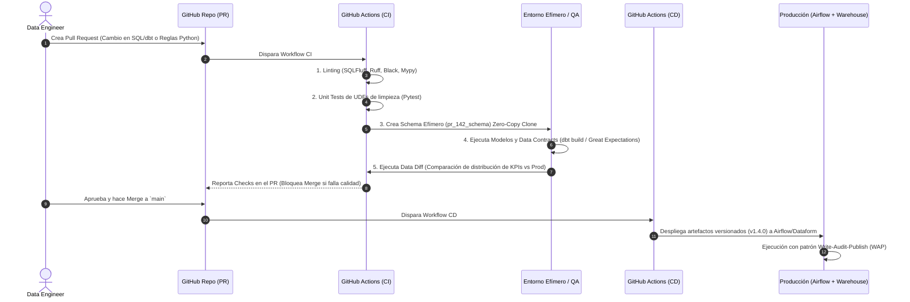

# 1. Arquitectura y Proceso CI/CD para la Creación del Dataset Confiable de Números de Teléfono de Clientes

## 1.1. Resumen Ejecutivo y Objetivo de Negocio

En una entidad financiera como **Tuya S.A.**, el número de teléfono del cliente es un activo crítico para la operación omnicanal: cobranzas preventivas, alertas transaccionales (OTP/fraude), campañas comerciales, servicio al cliente (Contact Center / WhatsApp) y notificaciones legales (Ley 2300 de 2023 - "Dejen de Fregar" y Habeas Data Ley 1581 de 2012 en Colombia).

Actualmente, los datos de contacto suelen encontrarse fragmentados en múltiples sistemas transaccionales y canales (originación de tarjetas en almacenes Éxito/Carulla/Alkosto, Core Bancario, CRM, App Tuya, Portal Web, actualizaciones en Call Center y burós de crédito). El objetivo de esta arquitectura es **diseñar e implementar un pipeline de datos automatizado, gobernado mediante prácticas de DataOps y CI/CD**, que consolide, limpie, valide, deduplique y publique un **Golden Dataset de Teléfonos de Clientes (`dim_customer_phones_golden`)** con alta confiabilidad, trazabilidad de extremo a extremo y cumplimiento normativo.

---

## 1.2. Arquitectura de Datos Propuesta (Medallion Lakehouse + DataOps)

Se propone una arquitectura **Medallion (Bronze → Silver → Gold)** desplegada sobre una plataforma **Cloud Data Lakehouse** (ej. Google Cloud Platform con BigQuery / Cloud Storage / Dataform o dbt, o equivalente en AWS/Databricks), orquestada por **Apache Airflow (Cloud Composer)** y gobernada por **GitHub Actions** como motor de CI/CD.

### Detalle de las Capas de Datos

1. **Capa Bronze (aterrizaje crudo e inmutable):**
   - Ingesta mediante **CDC (Change Data Capture)** para bases transaccionales y lotes diarios/horarios vía APIs/SFTP para reportes de telcos.
   - Almacenamiento particionado por fecha de ingesta (`_ingestion_timestamp`), conservando el payload original junto con metadatos técnicos (`_source_system`, `_batch_id`, `_schema_version`).
   - Aplicación inmediata de **políticas de seguridad (Column-Level Security / Dynamic Data Masking)** al tratarse de **PII (Información Personal Identificable)**.

2. **Capa Silver (estandarización, limpieza y enriquecimiento):**
   - **Estandarización formato internacional `E.164`:** Limpieza de caracteres especiales, espacios, prefijos locales (`034`, `+57`, extensiones) y clasificación entre línea **Móvil** (10 dígitos en Colombia iniciando por `3`, ej. `300-351`) y **Fija** (indicativo nacional `601`-`608` + 7 dígitos).
   - **Detección de números basura / sintéticos:** Filtrado determinístico de secuencias inválidas o de relleno en punto de venta (`3000000000`, `3111111111`, `1234567890`, números repetidos en más de $K$ clientes distintos no relacionados que indican fraude o mal hábito del asesor comercial).
   - **Enriquecimiento con Feedback Operacional:** Cruce con logs de pasarelas de comunicación (Twilio/Infobip/ Masivian) para adjuntar señales de rebote duro (*Hard Bounce*), línea desconectada o entrega exitosa en WhatsApp/SMS.
   - **Cuarentena (`int_phones_quarantine`):** Todo registro que falle las validaciones sintácticas no se destruye silenciosamente; se desvía a una tabla de cuarentena con el código de causal de rechazo (`ERR_INVALID_LENGTH`, `ERR_REPEATED_DIGITS`, `ERR_BLACKLISTED_PREFIX`) para retroalimentar a los equipos de captura.

3. **Capa Gold (`dim_customer_phones_golden` - Golden Record y SCD Tipo 2):**
   - **Resolución de Entidades y Ranking de Confiabilidad (Survivorship Rules):** Un cliente puede tener múltiples teléfonos activos o históricos. Se calcula un **`trust_score` (0 a 100)** ponderando:
     - *Verificación fuerte (OTP / 2FA en App Tuya):* +45 pts.
     - *Interacción reciente exitosa (SMS entregado / llamada contestada últimos 30 días):* +25 pts.
     - *Recencia de actualización en fuente primaria:* +20 pts.
     - *Penalización por rebotes o compartir teléfono con >3 cédulas:* -40 a -100 pts.
   - **Priorización (`phone_rank = 1`):** Se marca el teléfono principal móvil y fijo por cliente, junto con las banderas de consentimiento legal (`is_whatsapp_opt_in`, `is_sms_opt_in`, `allowed_contact_window` según Ley 2300).
   - **Historia SCD Tipo 2 (`valid_from`, `valid_to`, `is_current`):** Permite auditoría histórica para saber qué número tenía asignado un cliente en cualquier fecha pasada.

---

## 1.3. Contrato de Datos del Dataset Objetivo (`dim_customer_phones_golden`)

El dataset final se rige por un **Data Contract (YAML / JSON Schema)** versionado en Git:

| Campo | Tipo | Restricción | Descripción |
| :--- | :--- | :--- | :--- |
| `customer_phone_sk` | `STRING` | `PK, NOT NULL` | Llave subrogada determinística (`SHA256(customer_id \|\| phone_e164 \|\| valid_from)`). |
| `customer_id` | `STRING` | `NOT NULL` | Identificación única del cliente en Tuya. |
| `phone_e164` | `STRING` | `NOT NULL, REGEX(^\+57[36][0-9]{9}$)` | Número normalizado en estándar internacional E.164 (con Policy Tag `PII_CONFIDENTIAL`). |
| `phone_type` | `STRING` | `IN ('MOBILE', 'LANDLINE')` | Tipo de línea telefónica. |
| `is_primary` | `BOOLEAN` | `NOT NULL` | `TRUE` para el mejor número activo del cliente (`rank = 1` por `trust_score`). |
| `trust_score` | ` NUMERIC(5,2)` | `BETWEEN 0 AND 100` | Puntaje de confiabilidad calculado del teléfono. |
| `verification_status` | `STRING` | `IN ('VERIFIED_OTP', 'CONFIRMED_CALL', 'UNVERIFIED', 'BOUNCED')` | Estado de verificación del contacto. |
| `consent_commercial` | `BOOLEAN` | `NOT NULL` | Autorización vigente para contacto comercial (Ley 1581 / Ley 2300). |
| `consent_collections` | `BOOLEAN` | `NOT NULL` | Habilitado para gestión de cobranza en canales autorizados. |
| `source_system_winner` | `STRING` | `NOT NULL` | Sistema fuente que aportó la versión ganadora del dato. |
| `last_verified_at` | `TIMESTAMP` | `NULLABLE` | Fecha de última confirmación o entrega exitosa de mensaje/llamada. |
| `valid_from` | `TIMESTAMP` | `NOT NULL` | Inicio de vigencia del registro (SCD2). |
| `valid_to` | `TIMESTAMP` | `NULLABLE` | Fin de vigencia del registro (`NULL` si está vigente). |
| `is_current` | `BOOLEAN` | `NOT NULL` | Indicador de registro activo actual. |

---

## 1.4. Pipeline de CI/CD y Prácticas DataOps

Para garantizar que ningún cambio en las reglas de estandarización, deduplicación o esquema degrade el dataset en producción, se implementa un flujo **GitFlow / Trunk-Based Development con Entornos Aislados (`dev`, `qa/staging`, `prod`)**:

### Etapas de Integración Continua (CI - en cada Pull Request)
1. **Análisis Estático y Linting de Código:**
   - **Python:** `ruff`, `flake8`, `black` y chequeo estricto de tipos con `mypy`.
   - **SQL:** `sqlfluff` para obligar estándares de escritura SQL (CTEs explícitas, prohibición de `SELECT *`, convenciones de nombres).
2. **Pruebas Unitarias (Unit Testing):**
   - Pruebas determinísticas sobre funciones de normalización telefónica (ej. transformar `"(604) 510-9000 ext 12"` → `"+576045109000"`, rechazar `"3000000000"`, validar prefijos de operadores móviles colombianos).
3. **Pruebas de Integración en Esquemas Efímeros (Slim CI):**
   - Mediante **Zero-Copy Cloning** del Data Warehouse, el pipeline levanta un esquema temporal `ci_pr_<id>` y ejecuta únicamente los modelos modificados y sus dependientes (`state:modified+`).
4. **Validación de Contratos y Reglas de Calidad:**
   - Se ejecutan pruebas de esquema y contenido (`not_null`, `unique` de un solo teléfono primario activo por cliente, `accepted_values`, umbrales de volumetría).
5. **Data Diff Automatizado:**
   - Compara el impacto del cambio entre el esquema del PR y Producción (ej. *"El cambio en la regla de sobrevivencia modifica el teléfono principal del 1.8% de los clientes y aumenta el `trust_score` promedio en +3.2 pts"*).

### Etapas de Despliegue Continuo y Operación Continua (CD & Patrón WAP)
1. **Despliegue Inmutable y Versionado Semántico:**
   - Al fusionar a `main`, se genera un artefacto versionado (`vX.Y.Z`) y se sincronizan los DAGs en el orquestador sin intervención manual en consola.
2. **Patrón Write-Audit-Publish (WAP) en Ejecución Productiva:**
   - **Write:** El job diario escribe la nueva versión de `dim_customer_phones_golden` en una tabla staging/partición candidata oculta al negocio.
   - **Audit:** Se corren los sensores de calidad en producción (ej. verificar que el total de clientes activos no caiga más de un 1% respecto al día anterior — *Circuit Breaker* contra caídas de fuentes).
   - **Publish:** Solo si el 100% de las auditorías críticas pasan, se realiza un intercambio atómico (`ALTER TABLE SWAP` o actualización de vista/puntero) exponiendo los datos a los sistemas de negocio. Si falla, el dataset anterior permanece intacto y se dispara alerta inmediata a PagerDuty/Slack.

---

## 1.5. Seguridad, Privacidad (Habeas Data) y Mantenimiento

- **Protección de PII:** Enmascaramiento dinámico (*Dynamic Data Masking*) en entornos no productivos y para roles analíticos que no requieren ver los dígitos completos (ej. mostrando `+57300*****89`), dejando el dato en claro únicamente para los *Service Accounts* de los motores de contactabilidad autorizados.
- **Cumplimiento Ley 2300 de 2023 ("Ley Dejen de Fregar"):** El pipeline integra como dependencia dura (`blocker`) la tabla de revocatoria de consentimiento y horarios permitidos, asegurando que ningún consumidor aguas abajo contacte a un cliente por un canal no autorizado.
- **Retroalimentación en Bucle Cerrado (Closed-Loop Maintenance):** Los resultados de cada campaña de SMS/WhatsApp/IVR regresan diariamente a la capa Bronze (`raw_telco_feedback`), degradando automáticamente el `trust_score` de números que rebotan y promoviendo el siguiente mejor teléfono válido del cliente sin requerir cambios de código.

