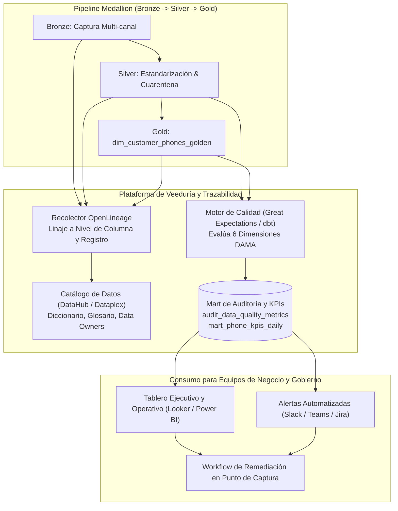

# 2. Gobierno, Observabilidad, Trazabilidad y KPIs de Calidad del Dataset de Teléfonos

## 2.1. Visión General del Mecanismo de Veeduría

Construir el *Golden Dataset* de teléfonos (`dim_customer_phones_golden`) es solo la mitad del reto; para que los equipos de negocio de **Tuya S.A.** (Cobranzas, Servicio al Cliente, Riesgo/Fraude, Mercadeo y Cumplimiento) confíen en él y optimicen sus operaciones, se requiere un **ecosistema integral de Gobierno de Datos, Observabilidad Activa y Autoservicio de KPIs**.

Esta solución se estructura en **cuatro pilares integrados**:
1. **Motor de Reglas de Calidad de Datos (Data Quality Engine):** Evaluación continua en cada ejecución del pipeline (Great Expectations / dbt Tests / Soda Core) que persiste resultados granulares en tablas de auditoría (`audit_data_quality_metrics`).
2. **Catálogo y Linaje de Datos de Extremo a Extremo (Data Lineage & Governance):** Integración vía **OpenLineage** con el catálogo corporativo (DataHub / Collibra / Dataplex) para rastrear cada teléfono desde su punto de captura hasta el canal de consumo.
3. **Capa Semántica y Tablero de Veeduría (Business & Technical KPI Dashboard):** Herramienta visual en **Power BI / Looker** conectada a la capa Gold de auditoría, ofreciendo vistas ejecutivas para negocio y operativas para Data Stewards.
4. **Sistema de Alertamiento Proactivo y Remediación (Data Incident Management):** Detección de anomalías (caídas de cobertura, picos de números inválidos en un almacén o canal específico) con enrutamiento automático al dueño del dato (*Data Owner*).

---

## 2.2. Trazabilidad del Dato (Data Lineage & Auditability)

El mecanismo garantiza **dos niveles complementarios de trazabilidad**:

### 1. Trazabilidad Técnica y de Metadatos (Column-Level Lineage)
Mediante la emisión de eventos **OpenLineage** desde el orquestador (Airflow) y el motor de transformación (dbt/Dataform):
- Los usuarios de negocio y auditores pueden visualizar el grafo completo de dependencias: qué tablas fuente alimentan `dim_customer_phones_golden`, qué regla SQL transformó el campo y qué reportes o campañas consumen ese atributo.
- **Análisis de Impacto:** Antes de modificar un sistema origen (ej. actualización del CRM), el catálogo identifica automáticamente qué KPIs y procesos de contacto se verían afectados.

### 2. Trazabilidad a Nivel de Registro (Row-Level Provenance & Explicabilidad)
Cada fila en `dim_customer_phones_golden` conserva metadatos de auditoría inmutables para responder en segundos a la pregunta de negocio o regulatoria *"¿Por qué llamamos a este cliente a este número el día X?"*:
- `source_system_winner`: Sistema origen que suministró el teléfono (ej. `APP_TUYA_OTP`, `ORIGINACION_EXITO_POS`, `CRM_SAC`).
- `source_updated_at` y `captured_by_channel_id`: Fecha exacta de captura y código de sucursal/canal (clave para detectar qué puntos físicos ingresan teléfonos falsos).
- `survivorship_reason`: Explicación estructurada en JSON de por qué ese número ganó la priorización (ej. `{"rule": "HIGHEST_TRUST_SCORE", "score": 92.5, "otp_verified": true}`).
- `pipeline_run_id` y `git_commit_sha`: Identificador de la ejecución y versión exacta del código que procesó el registro.

---

## 2.3. Catálogo de KPIs (Técnicos de Calidad y de Negocio / Contactabilidad)

Siguiendo el marco internacional **DAMA-DMBOK**, los indicadores se dividen en **KPIs de Calidad Intrínseca (Gobierno de Datos)** y **KPIs de Impacto de Negocio (Contactabilidad y Eficiencia Operativa)**:

### A. KPIs de Calidad de Datos (Dimensiones DAMA)

| Dimensión | Nombre del KPI | Fórmula de Cálculo | Meta (SLO) | Propósito para el Negocio |
| :--- | :--- | :--- | :--- | :--- |
| **Completitud** | **Cobertura de Teléfono Móvil (Customer Coverage Rate)** | $\frac{\text{Clientes activos con } \ge 1 \text{ móvil válido}}{\text{Total clientes activos}} \times 100$ | $\ge 96.0\%$ | Mide qué porcentaje de la cartera de Tuya es alcanzable por canales móviles. |
| **Validez** | **Tasa de Validez Sintáctica E.164 (Syntactic Validity Rate)** | $\frac{\text{Teléfonos que cumplen E.164 y prefijo operador}}{\text{Total teléfonos capturados en Bronze}} \times 100$ | $\ge 98.5\%$ | Detecta errores de digitación o captura en formularios web/POS antes de pasar a Gold. |
| **Exactitud / Veracidad** | **Índice de Teléfonos Verificados (Verified Phone Ratio)** | $\frac{\text{Clientes cuyo teléfono principal tiene OTP o entrega exitosa}}{\text{Clientes con teléfono válido}} \times 100$ | $\ge 85.0\%$ | Mide cuántos teléfonos realmente pertenecen al titular y están activos en la red celular. |
| **Unicidad** | **Tasa de Colisión / Uso Compartido Anómalo (Shared Phone Anomaly Rate)** | $\frac{\text{Teléfonos asociados a } > 3 \text{ identificaciones distintas}}{\text{Total teléfonos únicos en Gold}} \times 100$ | $< 0.5\%$ | Identifica fraude potencial o asesores comerciales que digitan su propio número o números comodín. |
| **Oportunidad (Timeliness)** | **Frescura del Dato (Data Freshness & SLA Compliance)** | $\text{Tiempo entre actualización en origen y disponibilidad en Gold}$ | $< 15 \text{ min (NRT)}$ / $< 6\text{ am (Batch)}$ | Garantiza que si un cliente cambia su número o revoca permiso hoy, no sea contactado al número antiguo. |
| **Consistencia** | **Índice de Cuarentena por Fuente (Source Quarantine Rate)** | $\frac{\text{Registros rechazados en } \texttt{int\_phones\_quarantine} \text{ por fuente}}{\text{Total registros enviados por esa fuente}} \times 100$ | $< 1.5\%$ | Permite hacer *ranking* de calidad de captura por canal (App vs. Tienda física vs. Call Center). |

### B. KPIs de Negocio y Operación (Equipos de Servicio al Cliente, Cobranzas y Mercadeo)

1. **Tasa de Contactabilidad Efectiva (Effective Right-Party Contact - RPC):**
   $$\text{RPC} = \frac{\text{Contactos efectivos con el titular de la cuenta}}{\text{Total intentos de contacto realizados con el Golden Dataset}} \times 100$$
   *Valor:* Mide el retorno directo de usar el `trust_score` frente a llamar a teléfonos sin curar.
2. **Tasa de Rebote Duro por Canal (Hard Bounce / Disconnected Line Rate):**
   $$\text{Hard Bounce Rate} = \frac{\text{SMS / WhatsApp / Llamadas fallidas por número inexistente}}{\text{Total envíos realizados}} \times 100$$
   *Valor:* Reduce el gasto directo en proveedores de mensajería (ahorro financiero por no enviar SMS a líneas muertas).
3. **Cobertura de Contactabilidad Legalmente Habilitada (Compliant Reachable Base):**
   $$\text{Compliant Reachable Base} = \frac{\text{Clientes con teléfono válido } \land \text{ Consentimiento Activo } \land \text{ Dentro de cupo Ley 2300}}{\text{Total clientes objetivo de la campaña}} \times 100$$
   *Valor:* Protege a Tuya S.A. de sanciones de la Superintendencia Financiera (SFC) y Superintendencia de Industria y Comercio (SIC).
4. **Edad Promedio de Verificación (Mean Time Since Last Verification - MTSLV):**
   Promedio de días transcurridos desde la última interacción exitosa (`CURRENT_DATE - last_verified_at`). Si supera los 180 días, el registro se marca para campaña preventiva de actualización de datos en App/Cajero.

---

## 2.4. Diseño de la Herramienta de Veeduría (Tablero de Control + Alertas)

La herramienta de veeduría se implementa como un **Portal de Observabilidad en Power BI / Looker** alimentado por el modelo analítico `mart_phone_kpis_daily`, organizado en **3 vistas especializadas**:

### Vista 1: Resumen Ejecutivo de Salud de Contactabilidad (Para Líderes de Negocio)
- *Scorecards* principales: **Cobertura Total de Clientes (%)**, **Score Promedio de Confiabilidad (`trust_score`)**, **Base Alcanzable por WhatsApp/SMS con Consentimiento (%)** y **Ahorro estimado por filtrado de números inválidos ($ COP)**.
- Evolución histórica mensual de la contactabilidad efectiva (RPC) vs. tasa de rebote.

### Vista 2: Auditoría de Captura por Canal y Almacén (Para Operaciones y Calidad)
- **Mapa de calor / Ranking de canales de entrada:** Muestra qué canales (ej. *Tienda Éxito X*, *Formulario Web Y*, *Proveedor Call Center Z*) están inyectando la mayor proporción de teléfonos en cuarentena (`int_phones_quarantine`) y el top de causales (`ERR_REPEATED_DIGITS`, `ERR_SHARED_PHONE`).
- Permite a los líderes comerciales corregir validaciones en el *front-end* de captura o capacitar asesores en tienda.

### Vista 3: Trazabilidad e Inspector de Clientes / Linaje (Para Data Stewards y SAC)
- Buscador por `customer_id` (con datos enmascarados según rol) que muestra el historial completo de teléfonos del cliente (SCD Tipo 2), el origen de cada uno, su `trust_score` desglosado y el historial de consentimiento Ley 2300.
- Estado en tiempo real de los **SLOs del Pipeline** (última ejecución exitosa, pruebas de calidad pasadas/fallidas y enlace directo al grafo de linaje en DataHub).

